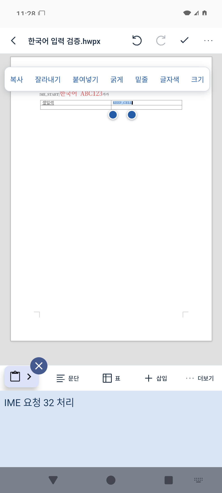
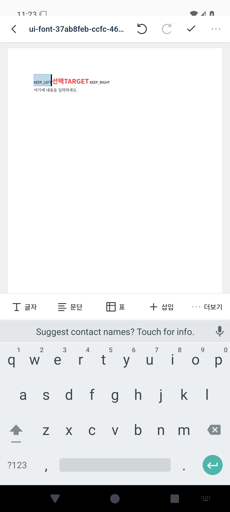
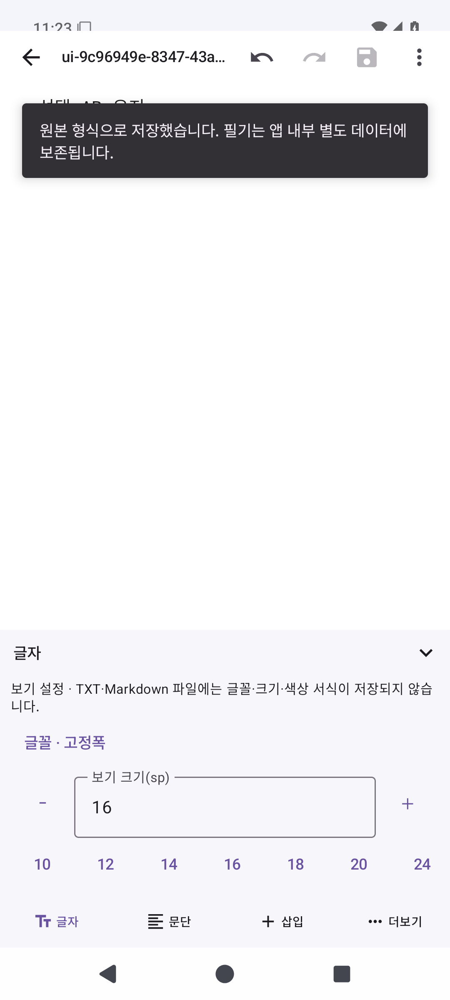

# 모바일 공통 편집 UI 개선 (0.8.5-preview)

같은 Android 프로젝트와 Rhwp 0.8.7 / Collabora 엔진을 유지했다. 확인 가능한 0.8.4 원격 소스에서 수정했으며, 과거 미푸시 0.8.0 소스를 복구한 결과가 아니다.

## 결과와 배포

- APK 빌드: [10ab10e01e027c35af3083e5d22a9e14b02c4f50](https://github.com/Ch-wook/File_Translator/commit/10ab10e01e027c35af3083e5d22a9e14b02c4f50). [전체 빌드·검증 실행](https://github.com/Ch-wook/File_Translator/actions/runs/40494582093): 성공.
- 소스 아카이브·배포 태그: [8c1ddc7156136d191a94323c49b51847c554da6e](https://github.com/Ch-wook/File_Translator/commit/8c1ddc7156136d191a94323c49b51847c554da6e). 태그의 추적 파일 **500개**를 ZIP과 바이트 단위로 대조했다. 앱·엔진 소스는 APK 빌드와 동일하며 문서·CI만 갱신했다.
- [실제 Release](https://github.com/Ch-wook/File_Translator/releases/tag/v0.8.5-preview): APK·소스·패치·Git 이력·검증 자료·해시 등 **9개 파일 게시 완료**. [게시·읽기 확인 실행](https://github.com/Ch-wook/File_Translator/actions/runs/40496987073)에서 인증 없는 공개 다운로드 9개의 크기·SHA-256을 모두 검사했다. [확인서](releases/0.8.5-preview-download-verification.json).
- [ARM64 휴대폰 APK](https://github.com/Ch-wook/File_Translator/releases/download/v0.8.5-preview/document-studio-0.8.5-preview-arm64-v8a.apk) · [x86_64 APK](https://github.com/Ch-wook/File_Translator/releases/download/v0.8.5-preview/document-studio-0.8.5-preview-x86_64.apk) · [소스 ZIP](https://github.com/Ch-wook/File_Translator/releases/download/v0.8.5-preview/document-studio-0.8.5-preview-source.zip) · [검증 ZIP](https://github.com/Ch-wook/File_Translator/releases/download/v0.8.5-preview/document-studio-0.8.5-preview-verification.zip) · [SHA256SUMS](https://github.com/Ch-wook/File_Translator/releases/download/v0.8.5-preview/SHA256SUMS).

기존 앱을 보존하는 별도 프리뷰 **문서 스튜디오 모바일 UI**(`kr.documentstudio.compactpreview`, versionCode 15)이다. 이전 개인 서명키를 복구한 업데이트가 아니다. Android 10 이상 64비트 ARM64 / x86_64를 지원하며 Office 엔진은 Android 11 이상이다. 실제 ARM64 휴대폰, 삼성 키보드 및 Gboard 검증은 미완료다.

## 실제 변경

- 한글과 Office가 [같은 DOM 도구·글꼴 목록·설정 패널](../shared/editor-ui/dist)을 재사용한다. PDF/TXT/Markdown은 [MobileEditorControls](../app/src/main/java/kr/documentstudio/ui/MobileEditorControls.kt)를 공유한다.
- 상단은 문서명·뒤로/보기 전환·undo/redo·저장·더보기 한 줄, 하단은 기본 도구 한 줄이다. 상세 설정은 기본적으로 닫혀 있고 높이를 제한해 스크롤·내리기·닫기를 지원한다. 큰 상시 안내와 중복 도구줄을 없애고 기존 기능의 접근 위치를 옮겼다.
- HWP/HWPX 눈금자는 기본 숨김이다. 문서 메뉴에서 켤 수 있다. 최초 열기는 화면 너비에 맞추며 저장된 위치가 있으면 배율과 스크롤을 복원한다. 두 손가락 확대는 문서 글자 크기·서식을 바꾸지 않는다.
- 글꼴 검색·현재/최근 글꼴·미리보기를 제공한다. 실제 번들 또는 엔진이 보고한 글꼴만 선택 목록에 표시한다. 일부 Office 글꼴의 미리보기는 기본 글꼴임을 표시한다. 원본 표시용 대체 글꼴 별칭을 실제 설치된 글꼴로 위장하지 않는다.
- Office에는 번들 Noto Sans KR 파일을 실제 엔진 글꼴 디렉터리에도 공급한다. 네이티브 목록의 이름은 **Noto Sans KR Thin**일 수 있다. 글꼴·크기·색상은 실제 UNO 명령으로 적용한다.
- 그림이 선택된 Office 문서에서도 더보기의 표·셀·슬라이드 도구로 해당 문서 구조 도구에 접근할 수 있다.
- 숫자 설정을 바꾸자마자 저장해도 대기 중인 서식 값을 먼저 반영한다. 패널을 연 채 문서의 다른 부분을 선택하면 새 선택 범위에 적용한다. 조합 중인 글자를 임의로 확정하는 도구 동작은 제한한다.
- TXT/Markdown 글꼴·크기는 **보기 설정**이며 원본에 저장되는 서식이 아니다. 보기 글꼴 변경은 텍스트·선택·파일 바이트를 바꾸지 않는다. Markdown 굵게·목록·표 등은 기존 구문 편집이다.
- PDF는 기존 캔버스와 페이지·양식·주석·필기·이미지 도구를 유지하며 같은 하단 패널로 이동했다. 확대는 같은 캔버스의 보기 배율만 바꾼다.
- 원본/작업 복사본 분리, 읽기 상태에서 쓰기 차단, 승인한 편집 결과만 반영, 기존 충돌·백업·실패 복구와 저장 형식을 유지했다.

## 형식별 구현·부분 지원·미구현

| 형식 | 실제 연결 기능 | 제한 |
|---|---|---|
| HWP/HWPX | 부분 선택 글꼴·크기·굵게/기울임/밑줄/취소선·색/음영, 자간·장평·위치, 문단·목록·표·그림·검색·기존 스타일 | 복잡한 요소는 기존 엔진 보존 검사에 따름. 형광펜과 배경은 같은 음영 속성. 새 그림 자르기·교체·둥근 모서리, 새 맞춤법/수식/목차/책갈피 도구는 미구현 |
| DOC/DOCX | 같은 글꼴/크기/스타일/색상 패널, 문단·표·개체·삽입, 원본 형식 저장 | 자간·장평·문단 세부 설정은 기존 네이티브 대화상자 이용. 기본 글꼴만 복원하는 별도 버튼은 없음 |
| XLS/XLSX | 공통 글꼴/크기/색상, 실제 셀·행·열·함수·셀 서식, 기존 수식 입력줄·시트 유지 | 워드 문단 기능을 셀 구조에 강제로 적용하지 않음 |
| PPT/PPTX | 공통 글꼴/크기/색상, 슬라이드·텍스트 상자·개체, 기존 슬라이드 UI | 개체 편집 범위는 실제 엔진 지원에 따름 |
| PDF | 공통 상단/하단/패널, 원본 페이지·허용 본문/이미지·페이지/양식/주석 | 기존 본문 글꼴 교체·자간/장평·문단 재배치는 지원하지 않음 |
| TXT | 공통 UI, 입력·선택·클립보드·기존 검색/바꾸기, 보기 글꼴·크기 | 글꼴·색상 등 원본 서식 없음. 기존 TXT 검색/바꾸기를 리치 텍스트 검색으로 표시하지 않음 |
| Markdown | 공통 UI, 기존 구문 편집·표·목록·제목·링크·미리보기 | 리치 텍스트 글꼴·색상·셀 병합 저장 형식이 아님 |
| HTML | 기존 편집기가 없음 | 새 지원 형식으로 추가하지 않음 |

고급 기능의 기존 엔진 메뉴는 유지했지만 모든 복잡한 HWP/Office 요소를 새 UI에서 종합 검증한 것은 아니다. 문서의 실제 레이아웃을 유지하며 구조 있는 문서를 추출 텍스트 입력창으로 대체하지 않는다. 인쇄·인쇄 미리보기·PDF 출력 기능을 새로 추가하지 않았다.

## 원인을 확인하고 수정한 오류

1. **Office 서식 값 유실**: Android용 `filterExecCopyPaste`가 모든 UNO 명령을 소비하며 인수를 버렸다. 크기를 눌러도 바뀌지 않고 글꼴 변경 시 불필요한 글자 모양 대화상자가 열렸다. 클립보드 명령은 기존 클립보드 경로를 사용하고, 글꼴·색상은 인수를 유지한 네이티브 UNO, 크기는 엔진의 `applyFontSize`로 전달한다.  실제 번들 엔진 코드와 Android 실패 화면으로 원인을 확인했다.
2. **저장 직후 도구 가림**: 기존 하단 Snackbar가 새 하단 도구를 덮었다. 알림을 문서 상단 안쪽으로 옮겨 저장 직후에도 도구를 누를 수 있게 했다.
3. **패널의 오래된 선택**: 패널을 연 뒤 문서 선택을 바꿔도 이전 범위가 남을 수 있었다. 실제 선택 이벤트에 맞춰 대상을 갱신하고 텍스트 편집기의 선택 콜백도 연결했다.
4. **Office 검색 연결**: 고정된 최신 엔진의 실제 검색은 `app.searchService`에 있다. 이전 `map.search` 경로 대신 이 서비스를 연결하고 네이티브 검색 결과를 기다린 뒤 선택 범위 서식을 검증한다.
5. **마지막 숫자 설정 누락**: 디바운스 대기 중 저장하면 마지막 서식 변경이 빠질 수 있었다. 저장·보기 전환 전에 설정을 먼저 반영한다.

문서 열기 오류의 기존 수정(메타데이터를 주지 않는 파일 제공자, 배포용 HWP, RESUMED 이후 호스트 열기, 마지막 한글 창 종료 시 프로세스/프로필 정리)은 유지했다. [별도 원인·검증](DOCUMENT_OPEN_FIX.md)을 참고한다.

## 실행 검증

2026-10-27 GitHub Actions에서 실제 실행한 결과다.

- Android 35 x86_64: **27건 통과, 실패·오류·건너뜀 0건**. 설치·기존 0.8.4 병행 설치/개인 데이터 보존·동일 서명 재설치, 외부 파일 열기, 원본 보기 기본값, 읽기 보호, 실제 InputConnection 한글 조합, 두 포인터 확대, 선택/서식, 네이티브 저장·재열기를 포함한다.
- 단위 테스트 **143건**: core 122, Office 2, app Robolectric 19. 실패·오류·건너뜀 0건.
- JavaScript **20건**, TypeScript `tsc --noEmit`, Android lint 통과.
- Rhwp 실제 Chromium **7개 시나리오**(기존 5 + 모바일 HWP/HWPX 2). 부분 글꼴·크기·색·독립 서식, 자간/장평의 실제 폭 변화, 선택/터치 핸들, 표 행/열 및 병합/나누기 3회, 그림 선택/이동/크기, undo, 검색/바꾸기, 마지막 설정 즉시 저장·자동 저장·재열기와 독립 HWP/HWPX 파서를 확인했다.
- 네이티브 Writer: 선택한 글자에 실제 `Noto Sans KR Thin`, 18pt, 굵게와 빨간색을 적용했다. 양옆 글자의 글꼴·크기 및 모든 원문 문단을 보존하고, DOCX XML 독립 검사와 엔진 재열기를 통과했다.
- DOCX 쪽 나누기·XLSX 열 삽입·PPTX 슬라이드 추가는 실제 버튼 터치 → 네이티브 명령 기록 → 저장 승인 → 독립 파서 → 원본 반영 → 엔진 재열기를 확인했다.
- TXT 보기 글꼴 변경은 선택·텍스트·저장 파일 바이트를 유지했다. Markdown은 패널을 연 뒤 새로 선택한 글자만 구문으로 변경하고 저장·재열기했다. PDF는 같은 캔버스에서 확대만 변경하고 원본 해시·변경 상태를 유지했다.
- 두 ABI APK: 서명 일치, 16KiB ELF/APK 정렬, `testOnly` 없음, INTERNET 권한 없음, 검사한 한글/공통/Office 자산과 APK 내 자산의 바이트 일치. ARM64는 패키지·무결성 검사, 실제 설치/실행은 x86_64 에뮬레이터 기준이다.

기존 0.8.4 APK에서 추출한 실제 엔진과 비교했다. 412×915 브라우저 화면에서 기본 고정 도구는 216px → 96px(상단 48 + 하단 48), 문서 iframe은 **699px → 819px**이다. 360×800과 412×500에서도 도구 높이 96px을 확인했다. 마지막 크기는 키보드 높이를 가정한 브라우저 화면이며 Android IME 결과와 구분한다.

| 사용자 확인 항목 | 확인 범위 |
|---|---|
| 상단 축소·문서 영역 증가 | 위 동일 화면 크기 전후 측정, Android 네이티브 헤더/하단 48dp 검사 |
| 글꼴 목록·선택 글자에만 적용·크기 | HWP/HWPX 실제 엔진, Android Writer 선택 서식 및 독립 DOCX XML |
| 굵게/기울임/밑줄/색의 독립성 | HWP/HWPX 부분 속성·인접 서식·저장 파서, Office 명령 전달 및 부분 크기/색/글꼴 |
| 실제 자간·장평 | HWP/HWPX 화면 폭 변화와 저장 데이터 재열기. Office 고급 대화상자 수치 조작은 별도 미검증 |
| 문단·줄 간격 | HWP/HWPX 선택 문단 범위와 저장, 기존 Office 명령 연결 |
| 표/그림 도구 자동 전환 | HWP/HWPX 실제 터치 시나리오, Office 선택 상태 명령 검사 |
| 키보드·선택·패널 | Android 테스트 IME의 HWP/HWPX 실제 InputConnection, TXT 보기 글꼴 선택 유지·MD 패널 열린 뒤 새 선택 서식 |
| 확대·커서 | Android HWP/HWPX 두 포인터 제스처와 편집, PDF 기존 캔버스 배율만 변경 |
| 저장·재열기 | HWP/HWPX 엔진+독립 파서, Writer 부분 서식과 DOCX/XLSX/PPTX 구조, TXT/MD 원문 |
| 공통 적용·기존 회귀 | HWP/Office 공유 자산 해시, PDF/TXT/MD 공통 컴포넌트, 열기·보기 보호·원본 해시·기존 설치 보존 |

검증용 에뮬레이터에서 AOSP Quickstep 런처의 ANR 안내가 발생한 화면도 수집했다. 앱 ANR을 무시하거나 숨기지 않았으며, 별도 런처 프로세스를 종료한 뒤 네이티브 Office 검사를 진행했다. 테스트 APK의 전용 IME는 배포 APK에 포함되지 않는다. 별도로 WebView 접근성 캐시에 남은 이전 버튼 참조와 IME 전환 중 움직이는 좌표를 확인해, 테스트에서 접근성 정보를 새로 조회하고 버튼을 CSS 스크롤 패널 안에 표시하고 위치가 안정된 뒤 실제 터치를 한 번만 주입하도록 보완했다. 네이티브 소켓에 실제 명령이 발생하는지도 별도로 확인한다. 저장 결과·원본 해시·재열기 검사를 제거하거나 실패를 건너뛰지 않았다.

실제 ARM64 휴대폰과 삼성/Gboard의 빠른 입력·긴 문서·모든 표/이미지 배치 조합은 아직 확인하지 않았다. 에뮬레이터의 테스트 IME를 실제 휴대폰 종합 검증으로 표시하지 않는다. DOC/XLS/PPT는 네이티브 읽기 표시를 검사했고 구조 편집 저장 검사는 DOCX/XLSX/PPTX 샘플 기준이다. 모든 형식·모든 문서의 서식 보존 보장이 아니다.

## 실제 수정 파일

- 공통 웹 도구: `shared/editor-ui/dist/studio-editor-ui.js`, `studio-editor-ui.css`.
- 한글 기존 화면: `web/hangul/index.html`, `host.css`, `host.js`, `mobile-tools.js`, `engine-adapter.ts`, `studio-mobile.ts`, `studio-touch.ts`.
- 네이티브 화면: `app/src/main/java/kr/documentstudio/ui/MobileEditorControls.kt`, `FormatWorkspace.kt`, `StudioApp.kt`, `LineNumberEditText.kt`, `PdfCanvasEditor.kt`.
- Office: `officeruntime/src/main/assets/dist/studio-policy.js`, `COWebViewClient.java`, `LOActivity.java`, `officeruntime/build.gradle.kts`.
- 빌드·앱 구분: `app/build.gradle.kts`, `app/src/main/AndroidManifest.xml`, `scripts/prepare-hangul-engine.py`.
- 실제 검증·배포: `CommonMobileUiTest.kt`, `NativeOfficeFontTest.kt`, `NativeUiActions.kt`, 기존 Android 회귀 테스트의 UI 접근 경로, `scripts/tests/mobile-ui-layout.cjs`, `hangul-mobile*.cjs`, `office-workspace.test.cjs`, `scripts/run-android-mode-tests.sh`, `package-mobile-release.py`, `test-mobile-installation.py`, 관련 CI. 전체 목록은 아래 비교 링크에 있다.

[0.8.4 기준과 검증한 변경 전체 비교](https://github.com/Ch-wook/File_Translator/compare/63944c500c5437e478f235598158159a36d99428...10ab10e01e027c35af3083e5d22a9e14b02c4f50).

## 실제 Android 화면

HWPX·DOCX·TXT 검증 화면 보기

Android 35 x86_64 에뮬레이터에서 위 빌드로 수집한 원본 화면이다. HWPX 아래쪽의 IME는 조합 검증용 테스트 서비스이며 배포 APK에 포함되지 않는다. [출처](screenshots/0.8.5-evidence.json).

HWPX 한국어 입력·표 셀 선택:

DOCX 선택 부분의 글꼴·18pt·빨간색과 인접 글자 보존:

TXT 보기 글꼴·크기 패널(원문 서식이 아닌 보기 설정):

